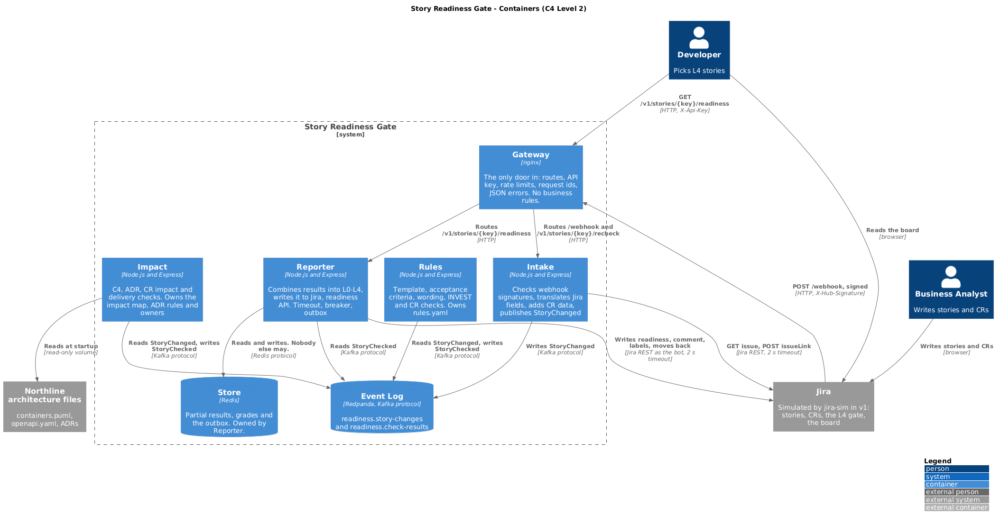

# Story Readiness Gate

**A Definition of Ready system for Jira.** It grades every user story from **L0 to L4** and blocks the move to "Ready for Dev" until the story is **L4**, so bad stories are caught when they are written, not mid-sprint.

Unlike generic story checkers, it checks each story against **the team's own architecture**: C4 containers, ADRs, the OpenAPI contract and approved Change Requests.

| | |
|---|---|
| **Status** | v1: four services, an API gateway and a Jira simulator. Runs locally with one command. |
| **Stack** | Node.js 20, Redpanda (Kafka API), Redis, nginx, Docker Compose |
| **Target system** | Northline Shop, an online shop (`architecture/`). Point the gate at another project by swapping that one folder. |
| **AI** | None in v1, on purpose. Rules decide, AI advises (ADR-007). |

---

## Contents

1. [The problem](#the-problem)
2. [How it works](#how-it-works)
3. [Maturity levels](#maturity-levels)
4. [Checks](#checks)
5. [Enforcement](#enforcement)
6. [Example: one story, end to end](#example-one-story-end-to-end)
7. [Architecture](#architecture)
8. [Repository layout](#repository-layout)
9. [Getting started](#getting-started)
10. [Walkthrough](#walkthrough)
11. [Resilience and operations](#resilience-and-operations)
12. [Quality gates](#quality-gates)
13. [Security](#security)
14. [Prior art](#prior-art)
15. [Roadmap and open questions](#roadmap-and-open-questions)

---

## The problem

| # | Problem | What the gate does |
|---|---------|--------------------|
| 1 | **Inconsistent stories.** Every BA writes differently. | A template check: `[Area]` title, As a / I want / so that |
| 2 | **Untestable acceptance criteria.** "Fast", "TBD", happy path only. | Given/When/Then, vague-word, open-question and negative-case checks |
| 3 | **Unknown impact.** Nobody knows which services a story touches. | Impact check against the target's C4 containers and OpenAPI |
| 4 | **Architecture broken at the requirement stage.** | ADR conflict checks, e.g. "stock changes must use events" |
| 5 | **Stories not requested, approved or in scope.** | Change Request (CR) traceability: linked, Approved, impact declared, nothing out of scope |
| 6 | **Half-ready stories reach the sprint and bounce back.** | A hard L4 gate on "Ready for Dev" and an L4-only developer board |
| 7 | **Readiness is opinion.** | One objective level and a comment that lists exactly what is missing |

**Limit:** the gate checks structure, not whether the requirement is right. Refinement meetings stay. The benefits above are what we intend; a small pilot will prove them (stories bounced back by developers, before and after).

---

## How it works

Stories are validated **after** they are saved and enforced **only** at "Ready for Dev". A BA can always save a draft, and nothing incomplete reaches developers.

1. The BA creates or edits a story. Readiness becomes **Pending**.
2. Jira sends a signed webhook through the gateway to **Intake**, which adds the CR data and publishes `StoryChanged`.
3. **Rules** and **Impact** check the story in parallel and each publish `StoryChecked`.
4. **Reporter** combines both results into a level, writes it to Jira, and posts a comment listing what is missing.
5. "Ready for Dev" is allowed only at **L4**. Below L4 the story stays in Refinement.
6. The developer board shows only L4 stories.
7. Any edit resets the story to Pending and re-runs the checks. A story that drops below L4 moves back to Refinement.

---

## Maturity levels

A story is at a level only when every blocking check at that level and below passes. Warnings never lower the level.

| Level | Meaning | Requires |
|-------|---------|----------|
| **L0** Not a draft | No story shape | (an L1 check fails) |
| **L1** Draft | Has the story shape | `[Area]` title; As a / I want / so that |
| **L2** Defined | Testable | Given/When/Then, a negative case, no vague words, no TBD |
| **L3** Refined | Impact known | Linked to a CR, impacted containers found, no ADR conflict, impact declared by the CR |
| **L4** Dev-ready | Can enter a sprint | No open dependencies, CR Approved and in scope, data owner named, event or API named |

Missing data caps the level: no acceptance criteria keeps a story at L1, and no CR link keeps it at L2. **Pending** is not a level; the gate treats it as "not ready". Details are in [`docs/maturity-levels.md`](docs/maturity-levels.md).

---

## Checks

Rule-based checks with clear evidence **block**; heuristics only **warn**, so nobody is blocked by a guess. Every check, its level and its message are in [`docs/checks.md`](docs/checks.md).

| Area | Service | Examples |
|------|---------|----------|
| Template | Rules | `[Area] Short phrase` title; As a / I want / so that filled |
| Acceptance criteria | Rules | Every line Given/When/Then; a negative case; no "quickly", "fast", "secure"; no "TBD" or "?" |
| INVEST | Rules | No "blocked by" links or "after X is done" (block); implementation detail or too many ACs (warn) |
| Change Request | Rules | CR linked, every CR Approved, nothing from the CR's out-of-scope list; due date after CR target (warn) |
| Containers | Impact | Story text matched to `containers.puml` through `impact-map.yaml` keywords; unknown systems (warn) |
| ADRs | Impact | One check per entry in `adr-rules.yaml`, e.g. ADR-002: stock changes must name an event |
| CR impact | Impact | Every impacted container is declared in the CR's impacted systems |
| Delivery | Impact | Data owner named; event or API path named when several containers are touched; new endpoints and security words (warn) |

Rules are YAML, owned by the service that uses them. Adding a vague word or an ADR rule is a config change, not a code change.

---

## Enforcement

| Layer | Strength | How |
|-------|----------|-----|
| **Grade** | Medium | Level L0 to L4 plus a comment that lists exactly what is missing |
| **Block** | Hard | The "Ready for Dev" transition requires L4 and a CR link. It reads the stored level, so it is instant and stays closed when the services are down. |
| **Hide** | Hard | The developer board shows only L4 stories |

Architects and product owners can **override** the gate, but a reason is required, so every bypass leaves a trace.

---

## Example: one story, end to end

Northline shop. CR-12, "Customers can reserve stock during checkout", is approved and declares one impacted system: Checkout.

| Step | What happens | Result |
|------|--------------|--------|
| 1 | BA writes "[Cart] Reserve stock", linked to CR-12. AC: "Stock should be reserved quickly. Reservation time TBD." | Pending |
| 2 | Graded: no Given/When/Then, "quickly" is not measurable, TBD is left, Warehouse is impacted but CR-12 declares only Checkout, ADR-002 needs an event | **L1** |
| 3 | BA tries "Ready for Dev" | **Blocked** |
| 4 | BA adds Given/When/Then with real limits and a `StockReserved` event; the architect adds Warehouse to CR-12 | Re-graded |
| 5 | CR approved and in scope, ADR-002 satisfied, data owner named | **L4**, on the board |
| 6 | Next day the PO adds "also apply a discount", which CR-12 puts out of scope | **L3**, moved back to Refinement |

The [walkthrough](#walkthrough) runs exactly this story.

---

## Architecture

Four event-driven services behind one API gateway, with Redpanda for events and Redis for partial results. The logic lives in backend services, not in a Jira plugin.



| Container | Owns | Role |
|-----------|------|------|
| **Gateway** (nginx) | Routes | The only door: API key, request ids, route control |
| **Intake** | Nothing | Anti-corruption layer: verifies signed webhooks, adds CR data, publishes `StoryChanged` |
| **Rules** | `rules.yaml` | Template, acceptance criteria, wording, INVEST and CR checks |
| **Impact** | `impact-map.yaml`, `adr-rules.yaml`, `owners.yaml` | C4, ADR, CR impact, data owner, event, API and security checks |
| **Reporter** | Partial results in Redis | Combines results into a level and is the **only** writer to Jira (timeout, circuit breaker, outbox) |
| **jira-sim** | Stories, CRs, links | Jira Cloud stand-in: REST paths, signed webhooks, the L4 gate and the board |

Contracts are in `api/`: the gateway OpenAPI, the simulator OpenAPI and the two event schemas. They are the only files services share.

### Architecture decisions

| ADR | Decision | Trade-off |
|-----|----------|-----------|
| [001](docs/adr/adr-001-each-service-owns-its-config.md) | Each service owns its own config | Enforced by a fitness function |
| [002](docs/adr/adr-002-events-between-services.md) | Services talk only through events | More moving parts; a stopped service catches up on restart |
| [003](docs/adr/adr-003-validate-async-enforce-at-gate.md) | Validate asynchronously, enforce at the gate | A few seconds before the level appears |
| [004](docs/adr/adr-004-external-services-thin-jira-app.md) | Logic in external services, a thin Jira app | Forge cannot host our services or event bus |
| [005](docs/adr/adr-005-intake-is-the-anti-corruption-layer.md) | Intake is the anti-corruption layer | Rules and Impact never call Jira |
| [006](docs/adr/adr-006-cr-from-jira-fields.md) | Read Change Requests from Jira fields | CRs must keep their fields filled |
| [007](docs/adr/adr-007-rules-decide-ai-advises.md) | Rules decide, AI advises | Some fuzzy issues only warn |
| [008](docs/adr/adr-008-own-jira-simulator.md) | Build and test against our own Jira simulator | Not every Jira behaviour is copied |
| [009](docs/adr/adr-009-one-api-gateway.md) | One API gateway is the only door | One more hop |

More design documents live in `docs/`: context ([`context.md`](docs/context.md)), stakeholders, context map, decomposition plan, API contract, event catalogue, SLO and AI readiness.

---

## Repository layout

```text
us-enforcer/
├── docker-compose.yml    # the system, plus tools: smoke, fitness, k6, diagrams
├── .env.example          # dev-only placeholders, never real secrets
├── api/                  # gateway + simulator OpenAPI, event schemas
├── architecture/         # the TARGET system being checked (Northline)
├── docs/                 # OUR architecture: C4, ADRs, SLO, design docs
├── gateway/              # nginx config; routes/ holds the webhook route
├── simulator/jira-sim/   # Jira stand-in
├── services/
│   ├── intake/           # signed webhooks in, StoryChanged out
│   ├── rules/            # checks + rules.yaml
│   ├── impact/           # checks + impact-map.yaml, adr-rules.yaml, owners.yaml
│   └── reporter/         # level, Jira client, breaker, outbox
├── samples/              # the sample CR and stories
├── tests/smoke/          # end-to-end smoke test
├── load/                 # k6 load test for the SLO
└── fitness/              # automated architecture rules
```

`docs/` is our system's architecture; `architecture/` is the target project's.

---

## Getting started

**Prerequisites:** Docker Desktop (engine running), git and curl. Everything else runs in containers. On Windows, use PowerShell and type `curl.exe` instead of `curl`.

```bash
git clone https://github.com/whereismyname7/us-enforcer.git
cd us-enforcer
docker compose up -d --build --wait
docker compose run --rm smoke
```

You should see 8 healthy containers (redpanda, redis, jira-sim, gateway, intake, rules, impact, reporter), and the smoke test ends with `ALL 14 STEPS PASSED`.

| Port | Service |
|------|---------|
| `9000` | Jira simulator |
| `9001` | API gateway |

Render the C4 diagrams with `docker compose run --rm diagrams`. Stop everything with `docker compose down`.

### Try the APIs in a browser (Swagger UI)

```bash
docker compose up -d swagger
```

Open http://localhost:9002. The **Story flow** page lists the steps in order: 1 Create, 2 Read the card, 3 Move to Ready for Dev, 4 Update, 5 Developer board. The page description says which example to pick at each step. Every request is prefilled: pick a body from **Examples**, then click **Execute**. The readiness API (second page) has its key already authorized. The same flow is in `postman/us-enforcer.postman_collection.json`. To start over: `docker compose restart jira-sim`.

---

## Walkthrough

The [example](#example-one-story-end-to-end) above, run against the simulator.

**Create the CR and a weak story**

```bash
docker compose restart jira-sim
curl -X POST http://localhost:9000/rest/api/v3/issue -H "Content-Type: application/json" --data-binary "@samples/crs/CR-12.json"
curl -X POST http://localhost:9000/rest/api/v3/issue -H "Content-Type: application/json" --data-binary "@samples/stories/reserve-stock-v1.json"
curl -X POST http://localhost:9000/rest/api/v3/issueLink -H "Content-Type: application/json" --data-binary "@samples/link-NORTH-1-CR-12.json"
```

**Read the grade** (a few seconds later)

```bash
curl http://localhost:9000/rest/api/v3/issue/NORTH-1
curl -H "X-Api-Key: dev-only-api-key" http://localhost:9001/v1/stories/NORTH-1/readiness
```

→ the card starts with `"level":"L1"` and lists 8 `missing` items, and the newest comment explains them. The service logs show `published`, `checked` twice and `graded`, all with the same `story_key`.

**The gate blocks it**

```bash
curl -i -X POST http://localhost:9000/rest/api/v3/issue/NORTH-1/transitions -H "Content-Type: application/json" --data-binary "@samples/transition-ready.json"
```

→ `400` and `This story is not ready for development.`

**Fix the CR and the story**

```bash
curl -X PUT http://localhost:9000/rest/api/v3/issue/CR-12 -H "Content-Type: application/json" --data-binary "@samples/crs/CR-12-update.json"
curl -X PUT http://localhost:9000/rest/api/v3/issue/NORTH-1 -H "Content-Type: application/json" --data-binary "@samples/stories/reserve-stock-v2.json"
curl http://localhost:9000/rest/api/v3/issue/NORTH-1
```

→ `"level":"Pending"` straight after the edit, then `"level":"L4"` with one warning, `Needs security review: payment`.

**The gate opens and developers see it**

```bash
curl -i -X POST http://localhost:9000/rest/api/v3/issue/NORTH-1/transitions -H "Content-Type: application/json" --data-binary "@samples/transition-ready.json"
curl http://localhost:9000/board
```

→ `204`, and the board lists `NORTH-1`.

**Scope creep moves it back**

```bash
curl -X PUT http://localhost:9000/rest/api/v3/issue/NORTH-1 -H "Content-Type: application/json" --data-binary "@samples/stories/reserve-stock-v3.json"
curl http://localhost:9000/rest/api/v3/issue/NORTH-1
```

→ `"level":"L3"`, `"discount" is out of scope for CR-12`, status back to `Refinement`, one comment saying so, and an empty board.

---

## Resilience and operations

**Catch-up.** A stopped consumer misses nothing; events wait in Redpanda.

```bash
docker compose stop impact
curl -X POST http://localhost:9000/rest/api/v3/issue -H "Content-Type: application/json" --data-binary "@samples/stories/gift-wrap.json"
docker compose start impact
curl http://localhost:9000/rest/api/v3/issue/NORTH-2
```

→ `"level":"Pending"` while Impact is down, then `"level":"L2"` (no CR linked) after it restarts.

**Horizontal scale.** `docker compose up -d --scale rules=3 --wait` runs three Rules copies in one consumer group.

**Liveness vs readiness.** `GET /v1/status/reporter` returns `503` with `"reason":"redis_not_connected"` while Redis is down, and `200` once it is back.

**Jira failures.** The Reporter has a timeout, a circuit breaker that opens after 3 failures, and an outbox that flushes after the cooldown. Turn on simulator chaos to see it work:

```bash
curl -X POST http://localhost:9000/admin/chaos -H "Content-Type: application/json" --data-binary "@samples/chaos-on.json"
curl -X POST -H "X-Api-Key: dev-only-api-key" http://localhost:9001/v1/stories/NORTH-2/recheck
docker compose logs --tail 15 reporter
curl -X POST http://localhost:9000/admin/chaos -H "Content-Type: application/json" --data-binary "@samples/chaos-off.json"
```

→ `jira_write_failed`, `outbox_saved`, `breaker_opened`, then `outbox_flushed`.

**Pausing validation.** In `gateway/routes/webhook-route.conf`, swap the LIVE lines for the PAUSED lines and run `docker compose exec gateway nginx -s reload`. Webhooks get `503`, new stories stay Pending and the gate stays closed (fail closed). Swap back and reload to resume, then `POST /v1/stories/{key}/recheck` any stories saved in the meantime.

**Gateway.** Every response carries `X-Request-Id` and `X-Readiness-Route`. Unknown routes return `404 route_not_found` and missing keys return `401 invalid_api_key`.

---

## Quality gates

| Gate | Command | What it proves |
|------|---------|----------------|
| Unit tests | `docker compose run --rm --no-deps rules npm test` (also `impact`, `reporter`) | Checks are pure functions, testable with nothing else running |
| Smoke test | `docker compose run --rm smoke` | 14 end-to-end steps through the real containers |
| Load test | `docker compose run --rm k6` | A 100-story burst meets the SLO (`graded_within_slo` ≥ 95%) |
| Fitness functions | `docker compose run --rm fitness` | No service reads another's config, events match the catalogue, no real secrets in the repo. Exit code `0` = pass. |

**SLO:** 95% of stories graded within 10 seconds of being saved, over a rolling 30 days. If more than half the error budget is spent before day 15, rule changes stop until reliability recovers. See [`docs/slo/readiness-slo.md`](docs/slo/readiness-slo.md).

---

## Security

- No real password, key or token is ever committed. Config uses placeholders such as `${WEBHOOK_SECRET}` or values starting with `dev-only-`; `.env` is git-ignored, and `fitness/no-secrets.js` fails the build on a real-looking secret.
- Webhooks are signed and verified by Intake.
- The gateway requires an API key (and rate-limits it) for the story readiness and recheck endpoints.
- Stories that mention payments, cards, passwords, tokens, IBANs, national ids or personal data get a `needs-security-review` label.
- v1 sends no data to any AI or outside service.

---

## Prior art

Parts of this exist, but we found no tool that checks stories against a team's own architecture and CRs **and** enforces a readiness gate. We searched the Atlassian Marketplace and the web on 2 Nov 2026; a closed enterprise product could still exist.

| Tool | What it does | What it lacks for us |
|------|--------------|----------------------|
| UserStory QE Agent | Validates stories against static rules, scores them, suggests rewrites | Generic rules; no architecture or CR awareness |
| Story Analyser | Grades stories A to E, flags big or ambiguous ones | Text only; no C4, ADRs or gate |
| StoryCraft AI | Generates stories, audits with INVEST checks | Generator first; no architecture checks |
| Acceptance Criteria for Jira | AC templates per project | Templates only, no validation |
| EpicViz | Draws C4 diagrams from epics | Opposite direction: tickets to diagrams |

---

## Roadmap and open questions

**Next**

- **Real Jira.** Point `JIRA_URL` at Jira Cloud and install a thin Forge app: a Readiness field and panel (with a "Link CR" button), an event listener, the "Readiness must be L4" workflow validator and a settings page. The app sends, displays and blocks; it never grades.
- **Confluence CRs.** Read scope from a linked Confluence page that uses a Page Properties template.
- **AI warnings.** Behind a setting and as warnings only: scope creep by meaning, synonym-aware impact mapping, duplicate detection and suggested rewrites, using Forge's Atlassian-hosted LLM so data stays inside Atlassian.
- **Governance.** A Jira admin can remove the validator; record this in an ADR and monitor it.

**Open questions**

- [ ] Do all Confluence CR pages use one template with In scope / Out of scope fields?
- [ ] Can we install Forge apps on our Jira, or do we need an Automation-rule fallback for the gate?
- [ ] Which pilot metric: stories bounced back, or time from Created to Ready for Dev?
